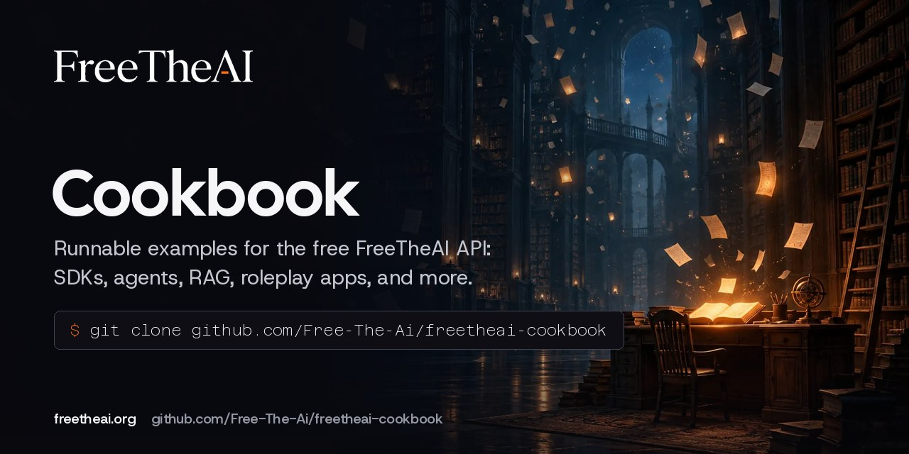

<p align="center">
  <a href="https://free-the-ai.github.io/freetheai-cookbook/"></a>
</p>

<p align="center">
  <a href="https://github.com/Free-The-Ai/freetheai-cookbook/actions/workflows/docs.yml"></a>
  <a href="LICENSE"></a>
  <a href="https://discord.gg/secrets"></a>
</p>

<p align="center">
  <b><a href="https://free-the-ai.github.io/freetheai-cookbook/">Documentation</a></b> ·
  <a href="https://freetheai.org/docs">FreeTheAI docs</a> ·
  <a href="https://freetheai.org/setup">App setup guides</a> ·
  <a href="https://freetheai.org/models">Models</a>
</p>

# FreeTheAI Cookbook

Runnable examples for the free, OpenAI-compatible [FreeTheAI](https://freetheai.org) API. Each recipe is in its own folder with a short README and the code to run it.

Use the official SDKs, the OpenAI clients with a different base URL, plain `curl`, or the frameworks you already know: LangChain, LlamaIndex, and the Vercel AI SDK.

## Setup

```bash
export FREETHEAI_API_KEY="ftai_..."   # create a key at https://freetheai.org/dashboard/api-keys
```

Do the [daily check-in](https://freetheai.org/checkin) once a day for the free models. The free tier is 50 requests a day, reset at 00:00 UTC.

Example model IDs used throughout: `fta/zai/glm-5.3`, `fta/zai/glm-5.3-flash`, `fta/kimi/k3`, and `fta/mmx/minimax-m3`. Check the live list with `GET https://api.freetheai.org/v1/models`.

## Recipes

| Recipe | What it shows |
| --- | --- |
| [`python-sdk`](python-sdk/) | The official `freetheai` Python SDK |
| [`openai-python`](openai-python/) | The OpenAI Python SDK with `base_url` pointed at FreeTheAI |
| [`js-sdk`](js-sdk/) | The official `freetheai` JavaScript SDK |
| [`openai-node`](openai-node/) | The OpenAI Node SDK with `baseURL` pointed at FreeTheAI |
| [`go-sdk`](go-sdk/) | The official Go SDK |
| [`curl`](curl/) | Raw HTTP with `curl` |
| [`streaming`](streaming/) | Streamed replies, printed as they arrive |
| [`tool-calling`](tool-calling/) | Function calling with a local function |
| [`web-search-answers`](web-search-answers/) | Web search and sourced answers |
| [`langchain`](langchain/) | `ChatOpenAI` with a custom `base_url` |
| [`llamaindex`](llamaindex/) | `OpenAILike` with a custom `api_base` |
| [`vercel-ai-sdk`](vercel-ai-sdk/) | `createOpenAICompatible` with the Vercel AI SDK |
| [`rag-local-files`](rag-local-files/) | A small retrieval-augmented answer over your own files |
| [`structured-output`](structured-output/) | JSON output that your code can parse |
| [`chat-cli`](chat-cli/) | A tiny chat program for the terminal |

## Apps and coding agents

For SillyTavern, JanitorAI, Claude Code, Cline, Cursor, and other apps, use the step-by-step guides at [freetheai.org/setup](https://freetheai.org/setup). They are kept up to date there, so this cookbook does not repeat them.

## More from FreeTheAI

- [Python SDK](https://github.com/Free-The-Ai/freetheai-python), [JavaScript SDK](https://github.com/Free-The-Ai/freetheai-js), and [Go SDK](https://github.com/Free-The-Ai/freetheai-go)
- [Free stock widgets](https://github.com/Free-The-Ai/free-stock-widgets) for live price cards and charts
- [freetheai.org](https://freetheai.org), [Discord](https://discord.gg/secrets)

## License

MIT. Built by [Vibhek Soni](https://vibheksoni.com).
