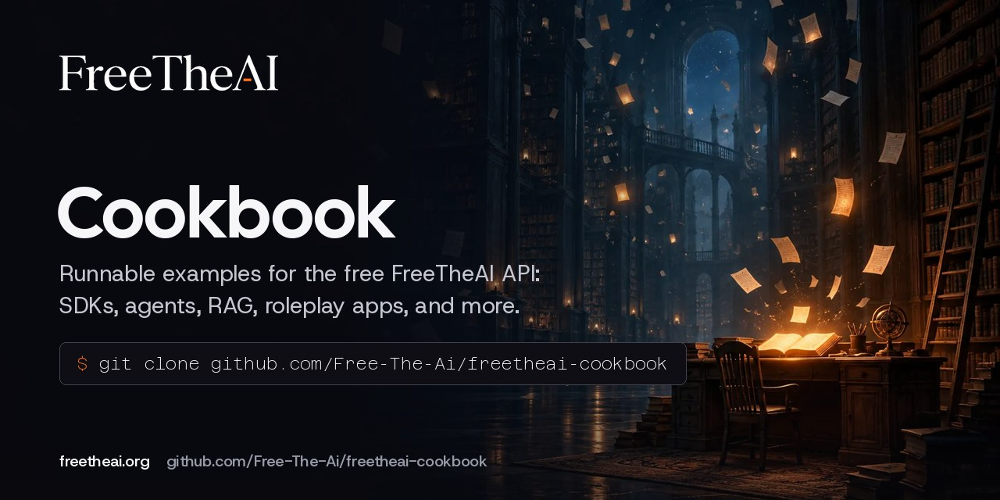

# FreeTheAI Cookbook



Runnable examples for the free, OpenAI-compatible [FreeTheAI](https://freetheai.org) API. Each recipe is a folder in the [repository](https://github.com/Free-The-Ai/freetheai-cookbook) with a short README and the code to run it.

Start with [Getting started](getting-started.md) for the key and the base URL, then pick a [recipe](recipes.md).

```python
from freetheai import FreeTheAI

client = FreeTheAI()  # reads FREETHEAI_API_KEY
reply = client.chat.completions.create(
    model="fta/zai/glm-5.3",
    messages=[{"role": "user", "content": "Hello!"}],
)
print(reply["choices"][0]["message"]["content"])
```

For apps such as SillyTavern, JanitorAI, Claude Code, Cline, and Cursor, use the guides at [freetheai.org/setup](https://freetheai.org/setup). They are kept up to date there.
